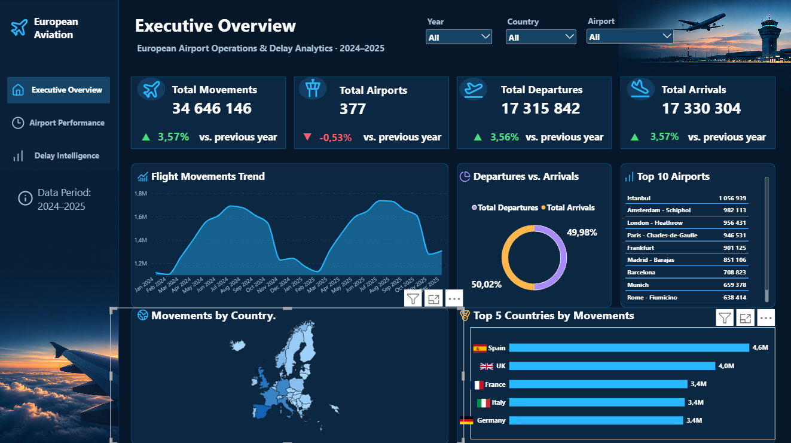
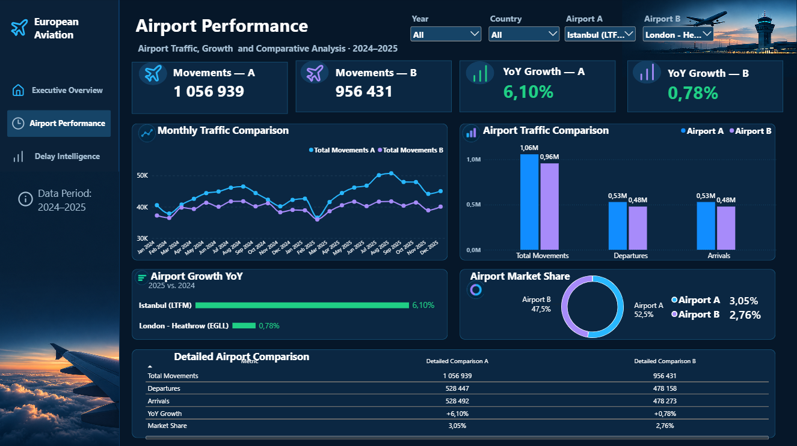
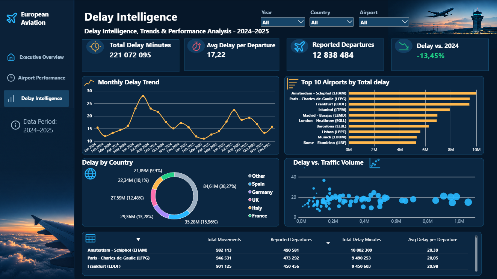

# ✈️ European Aviation Analytics

### European Airport Traffic & Delay Analysis | 2024–2025

An end-to-end data analytics project exploring European airport operations, air traffic trends, airport performance, and departure delays.

The project combines **PostgreSQL, SQL, Power BI, and DAX** to transform aviation data into an interactive, three-page business intelligence dashboard.

## 🛠️ Tech Stack

- **PostgreSQL:** Data storage and preparation
- **SQL:** Data transformation, joins, and analytical views
- **Power BI:** Interactive dashboard development and data visualization
- **DAX:** KPI calculations, year-over-year comparisons, and dynamic measures

## 📊 Dashboard Pages

### 1. Executive Overview

Provides an overview of European aviation activity, including flight movements, arrivals, departures, airport rankings, country comparisons, and geographic distribution.



### 2. Airport Performance

Enables interactive comparison of two selected airports, including traffic volumes, departures, arrivals, year-over-year growth, and market share.



### 3. Delay Intelligence

Analyzes departure delays across European airports, including delay trends, airport rankings, country-level distributions, and the relationship between airport traffic and average delay.



## 📈 Selected Insights

- **34.6 million** recorded flight movements across the analyzed dataset.
- **377 airports** represented in the operational data.
- **221.1 million minutes** of reported departure delays.
- **17.22 minutes** of average delay per reported departure.
- Average delay per reported departure decreased by approximately **13.45%** in 2025 compared with 2024.

*Results reflect the dataset and calculation definitions used in this dashboard. Some delay records are unavailable for certain airports or dates.*

## ⚙️ Project Structure

```text
European-Aviation-Analytics/
├── powerbi/
│   └── European_Aviation_Analytics.pbix
├── screenshots/
│   ├── 01_executive_overview.png
│   ├── 02_airport_performance.png
│   └── 03_delay_intelligence.png
├── sql/
└── README.md
```

## 🚀 How to Explore

1. Download `powerbi/European_Aviation_Analytics.pbix`.
2. Open the file in Power BI Desktop.
3. Explore the three dashboard pages using the interactive year, country, and airport filters.

Refreshing source data may require access to the original PostgreSQL database.

## 📌 Project Purpose

This project demonstrates practical skills in SQL-based data preparation, business intelligence, DAX calculations, analytical storytelling, and interactive dashboard design.
